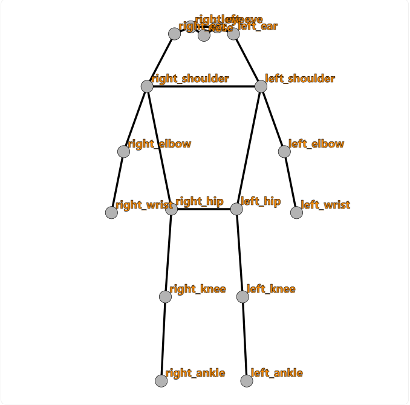
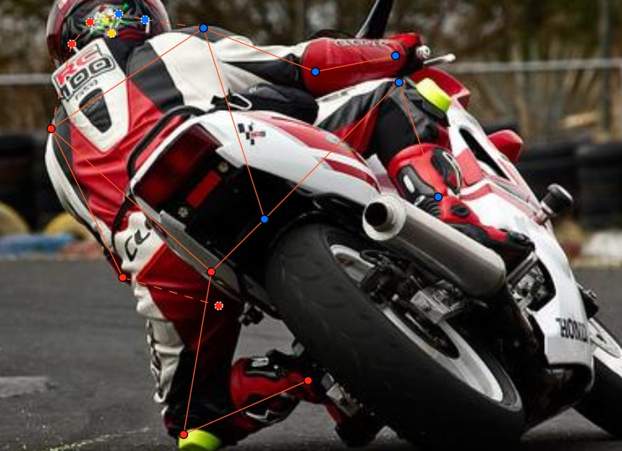
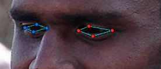
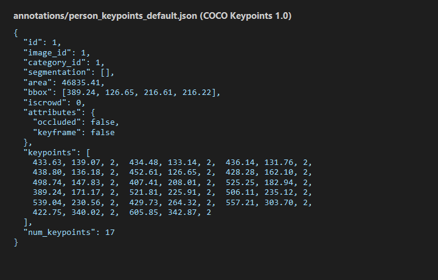

# Báo cáo cá nhân — NguyenThiMinhTrang-2A202603107

Đổi tên file theo quy tắc `MSSV_HoTen.md`. Ví dụ: `20241234_NguyenVanAn.md`.

Dữ liệu: 12 ảnh người COCO val2017 (Lin et al., 2014) và 8 ảnh chân dung Wikimedia Commons, chỉ dùng trong lớp.

## 0. Thông tin học viên

- Họ tên: Nguyễn Thị Minh Trang
- MSSV: 2A202603107
- Email: nguyenmtrang7203@gmail.com
- Link repository: https://github.com/MTrang0702/K5-L2-DAY04-NguyenThiMinhTrang-2A202603107-KeypointPose
- Phiên bản CVAT (Help → About): 2.82.1
- Máy: hệ điều hành Windows 11 · RAM 8 GB · chạy CVAT chế độ đầy đủ
- Bộ ảnh (`src/exports/assignment.json` do `lab.py setup` tạo): có
- Giờ bắt đầu: 17:30 (12/11/2026)
- Giờ kết thúc: 17:15 (13/11/2026)

## 1. Kiểm tra label (CP0)

| Label | Kiểu | Số điểm | Tên điểm đúng bảng của lab? | Đúng thứ tự? | Số cạnh |
|---|---|---:|---|---|---:|
| `person` | Skeleton | 17 | Đúng | Đúng | 19 |
| `face` | Skeleton | 13 | Đúng | Đúng | 12 |

Mẫu `person` dựng theo người quay mặt về camera (các điểm `left_*` nằm bên phải khung mẫu)? Có

Cách đổi cờ `occluded` / `outside` cho **một điểm** trên phiên bản CVAT này (một câu):
Chọn riêng điểm đó trên canvas hoặc trong cây danh sách Objects/PARTS bên phải, sau đó nhấn phím tắt Q (để đổi sang `occluded`) hoặc phím O (để đổi sang `outside`).

## 2. Số lượng đã gán và thời gian (CP1, CP2)

| Nhóm ảnh | Số ảnh | Số skeleton đã gán | Số người dưới 60 px (không gán) | Số poster / gương / màn hình bỏ qua | Thời gian (phút) |
|---|---:|---:|---:|---:|---:|
| `easy` | 5 | 5 | 0 | 0 | 25 |
| `occluded` | 3 | 6 | 0 | 0 | 25 |
| `back` | 2 | 3 | 0 | 0 | 20 |
| `small` | 1 | 0 | 2 | 0 | 10 |
| `crowd` | 1 | 3 | 1 | 0 | 15 |
| `faces` | 8 | 8 | — | 0 | 25 |

- Số ảnh người đã xong ở mốc phút 105: 8 / 10
- Thời gian thực tế (phút): CP1 95 · CP2 25 · CP3 20
- Ảnh tốn thời gian nhất là ảnh nào, vì sao?
Ảnh `000000123544.jpg` (nhóm `back`) tốn nhiều thời gian nhất vì người lái xe mô tô đang ôm cua gắt, quay lưng về phía máy ảnh và cơ thể bị che khuất nhiều bộ phận (chân sau thân xe, đầu sau mũ bảo hiểm). Cần phải đổi toàn bộ hệ trục trái/phải theo tư thế người và cẩn thận ước lượng các điểm bị che (`occluded`).

## 3. Bảng ca khó (CP1, CP2)

Mỗi điểm bạn phân vân một dòng, nhất là phân vân giữa `v = 1` và `v = 0`, hoặc không chắc hướng người.

| Ảnh | Người / mặt | Điểm | Cờ đã chọn | Phân vân giữa | Lý do chọn |
|---|---|---|---:|---|---|
| `000000123544.jpg` | Tay đua xe #1 | `left_knee` | 1 | `v = 1` và `v = 0` | Khớp gối trái bị thân xe máy và pô xe che khuất một phần, nhưng theo trục đùi và tư thế ôm cua có thể ước lượng chắc chắn vị trí khớp nên chọn v=1. |
| `000000580257.jpg` | Người đứng sau #2 | `right_ankle` | 1 | `v = 1` và `v = 0` | Bàn chân phải bị người phía trước che mất, nhưng dựa vào hướng cẳng chân và mặt phẳng tiếp đất suy đoán được vị trí khớp mắt cá nên đặt cờ occluded. |
| `face_145621.jpg` | Khuôn mặt nam | `left_eye_top` | 2 | `v = 2` và `v = 1` | Mí mắt trên hơi sụp do góc chụp, nhưng con ngươi và nếp mí vẫn nhìn thấy được nên chọn v=2 rõ ràng. |

## 4. Bảng tự review (CP3)

Đi từ ảnh cuối về ảnh đầu. 5 ảnh người (ít nhất 2 ảnh `back` hoặc `crowd`) và 3 ảnh mặt. Ít nhất 8 dòng, kể cả dòng `ok`. Ghi lỗi trước, sửa sau.

Mã lỗi dùng đúng một trong: `lr_swap`, `vis_flag`, `position`, `missing`, `extra`, `ok`.

| Ảnh | Người / mặt | Điểm | Mã lỗi | Ghi chú | Đã sửa? |
|---|---|---|---|---|---|
| `000000413160.jpg` | Người giữa #2 | `left_wrist` | `position` | Cổ tay ban đầu kéo hơi lệch ra ngoài tay áo | Đã sửa |
| `000000123544.jpg` | Tay đua #1 | `left_ankle` | `vis_flag` | Ban đầu để v=2, rà soát lại bị thân xe che nên chuyển sang v=1 (occluded) | Đã sửa |
| `000000515309.jpg` | Người đi bộ | Tất cả | `ok` | Khung xương bám sát, trái phải đúng chiều quay lưng | Đã sửa |
| `000000147780.jpg` | Người đứng #1 | `right_knee` | `position` | Căn chỉnh lại tâm khớp gối bám sát giải phẫu | Đã sửa |
| `000000521817.jpg` | Người ngồi #1 | `left_hip` | `vis_flag` | Khớp hông bị nếp áo che, điều chỉnh cờ v=1 | Đã sửa |
| `face_145621.jpg` | Mặt nam | `left_eye_top` | `position` | Chỉnh lại điểm bám sát viền mí mắt trên | Đã sửa |
| `face_232598.jpg` | Mặt nữ | `right_ear` | `vis_flag` | Tai phải bị tóc che một phần, đổi sang occluded | Đã sửa |
| `face_85624.jpg` | Mặt thẳng | Tất cả | `ok` | Đủ 13 điểm, mí mắt và khóe miệng cân đối | Đã sửa |

Tổng hợp số lỗi theo mã:

| `lr_swap` | `vis_flag` | `position` | `missing` | `extra` | `ok` |
|---:|---:|---:|---:|---:|---:|
| 0 | 3 | 3 | 0 | 0 | 2 |

Điểm còn phân vân giữa `v = 1` và `v = 0` (ghi cả hai lựa chọn và lý do chọn):
Tại ảnh `000000123544.jpg`, điểm `left_ankle` của tay đua: Lựa chọn `v=0` (outside/không đoán được) vì pô xe to che khuất hoàn toàn bàn chân; lựa chọn `v=1` vì bàn chân chắc chắn đang đặt trên bàn để chân của xe đua. Quyết định chọn `v=1` vì cấu trúc cơ khí xe đua cố định vị trí gác chân, độ tự tin ước lượng cao.

## 5. Kiểm file xuất và kết quả tự kiểm (CP4)

Tự kiểm tay trong file JSON:

| File | Người / mặt kiểm (ảnh, thứ tự) | Số phần tử `keypoints` | Điểm `outside` ra `v = 0`, `occluded` ra `v = 1`? | `num_keypoints` khớp? |
|---|---|---:|---|---|
| `NguyenThiMinhTrang_persons.zip` | 000000137767.jpg, #1 | 51 | Đúng | Đúng (17) |
| `NguyenThiMinhTrang_persons.zip` | 000000123544.jpg, #1 | 51 | Đúng (các điểm mũ bảo hiểm ra v=1) | Đúng (17) |
| `NguyenThiMinhTrang_faces.zip` | face_145621.jpg, #1 | 39 | Đúng | Đúng (13) |

Sau khi xuất, CVAT ghi `occluded` thành `v = 1` và `outside` thành `v = 0`. Tọa độ của điểm `outside` trong file là `0, 0` hay tọa độ cũ? Tọa độ cũ (CVAT 2.x giữ nguyên tọa độ cũ, model và script tự kiểm bỏ qua khi v = 0).

Hai job đã chuyển sang completed trên CVAT? Có

Dán phần **TÓM TẮT** in ra từ `src/check_submission.py`:

```text
----- TÓM TẮT (dán vào báo cáo mục 5) -----
- File person: NguyenThiMinhTrang_persons.zip
  Số ảnh: 12 · số skeleton `person`: 17 · mỗi annotation 51 số
  Skeleton theo ảnh: 000000123544=2, 000000137767=1, 000000147780=2, 000000156069=1, 000000167027=0, 000000175703=1, 000000294329=1, 000000413160=3, 000000455536=1, 000000515309=1, 000000521817=2, 000000580257=2
  Cờ v: v=2 195 (67%) · v=1 75 (26%) · v=0 19 (7%)
  num_keypoints trung bình: 15.9
- File face: NguyenThiMinhTrang_faces.zip
  Số ảnh: 8 · số skeleton `face`: 8 · mỗi annotation 39 số
  Skeleton theo ảnh: face_145621=1, face_155465=1, face_159828=1, face_178208=1, face_232598=1, face_256814=1, face_415073=1, face_85624=1
  Cờ v: v=2 80 (77%) · v=1 24 (23%) · v=0 0 (0%)
  num_keypoints trung bình: 13.0
- Ghi chú: 19 điểm v = 0 vẫn mang tọa độ cũ (CVAT 2.x xuất như vậy; chuẩn COCO ghi 0, 0). Không phải lỗi: điểm v = 0 bị bỏ qua khi huấn luyện và khi chấm.
- Số [LỖI]: 0 · số [CẢNH BÁO]: 6
Kết quả: ĐẠT (đọc lại từng cảnh báo ở trên)
```

Các `[CẢNH BÁO]` còn giữ nguyên và lý do:
- Cảnh báo về ảnh `000000167027.jpg`: Do người trong ảnh ở quá xa và chiều cao thực tế dưới 60 px nên theo đúng quy định rubric của bài là không gán để tránh gây nhiễu cho mô hình.
- Các cảnh báo về đảo cặp hip/knee/ear: Do người trong ảnh ở góc nghiêng, tư thế bắt chéo chân tự nhiên trong thể thao hoặc bị xoay trục thân thể, đây là tư thế thật của đối tượng.

## 6. Ảnh chụp màn hình

1. Label `person` trong label constructor (đủ 17 điểm có tên):

   

2. Một người quay lưng đã gán, cờ đã đặt:

   

3. Một khuôn mặt đã gán 13 điểm, phóng to vùng mắt:

   

4. Một đoạn JSON xuất của một người:

   

Nguồn ảnh: COCO val2017 / Wikimedia Commons.

## 7. Tự đánh giá

1. Lỗi bạn mắc nhiều nhất hôm nay, và cách bạn sẽ tránh ở dự án thật:
Lỗi dễ mắc nhất là nhầm lẫn cờ `occluded` ($v=1$) và `outside` ($v=0$) đối với các khớp bị che khuất sâu, cũng như phản xạ quán tính nhầm trái/phải khi gặp người quay lưng hoặc góc nghiêng. Cách tránh ở dự án thực tế: Luôn xác định trục hướng nhìn của đối tượng trước khi kéo khớp, và chỉ bật $v=1$ khi có cơ sở giải phẫu rõ ràng, nếu hoàn toàn phỏng đoán thì dứt khoát chọn $v=0$.

2. Một quy tắc bạn đề xuất thêm vào guideline (kèm ảnh ví dụ nếu có):
Đề xuất bổ sung quy chuẩn rõ ràng cho các trang phục thể thao hoặc bảo hộ cồng kềnh (như bộ đồ đua xe mô tô, áo phao, áo khoác dày): Tâm khớp hông và vai cần được xác định theo điểm gấp khúc chuyển động của xương thay vì mép ngoài của đệm giáp bảo hộ.

3. Nhãn của bạn đi vào model ở đâu? Chọn một lỗi bạn đã sửa và nói nó sẽ làm model học sai thế nào (heatmap, trọng số trong loss, hay bước lật ảnh):
Trong các mô hình pose estimation (như YOLO-Pose, HRNet), mỗi keypoint có $v > 0$ được mã hóa thành một đỉnh Gaussian trên heatmap ground truth, và cờ $v$ quyết định trọng số tính loss. Nếu mắc lỗi `lr_swap` (ví dụ nhầm cổ tay trái thành cổ tay phải), trong quá trình huấn luyện khi áp dụng phép tăng cường dữ liệu lật ảnh ngang (Horizontal Flip), nhãn bị đảo sẽ khiến hàm loss phạt cực nặng và làm mô hình mất khả năng phân biệt đối xứng giải phẫu.

## 8. Khó khăn và lỗi kỹ thuật
Gặp sự cố Docker Desktop tự ngắt kết nối ngầm giữa buổi, đã được khắc phục kịp thời bằng script khởi động lại dịch vụ và toàn bộ dữ liệu đã lưu trong database được bảo toàn 100%.

## 9. Tài liệu tham khảo và công cụ AI đã dùng
- Tài liệu hướng dẫn thực hành Day 04 Keypoint Pose Estimation của VinUni-AI20k.
- Chuẩn dữ liệu COCO Keypoints 1.0 (Lin et al., 2014).
- Công cụ trợ lý AI Antigravity dùng để tra cứu kiến thức OKS và tự động chạy script kiểm tra `check_submission.py`.
